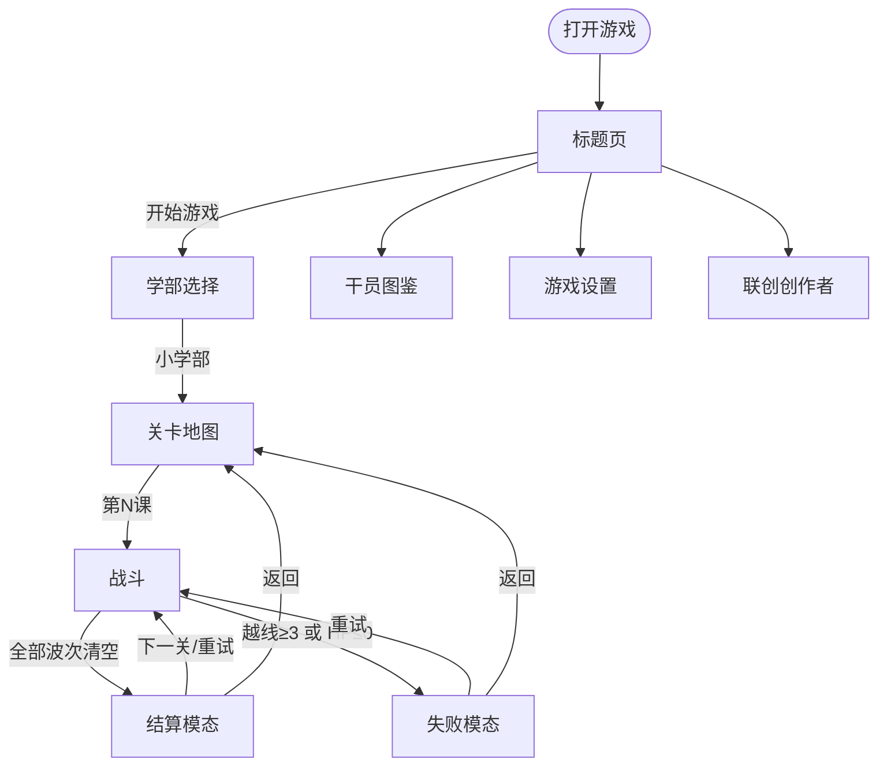
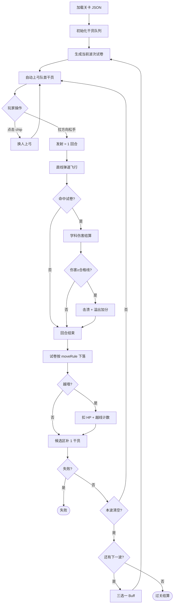
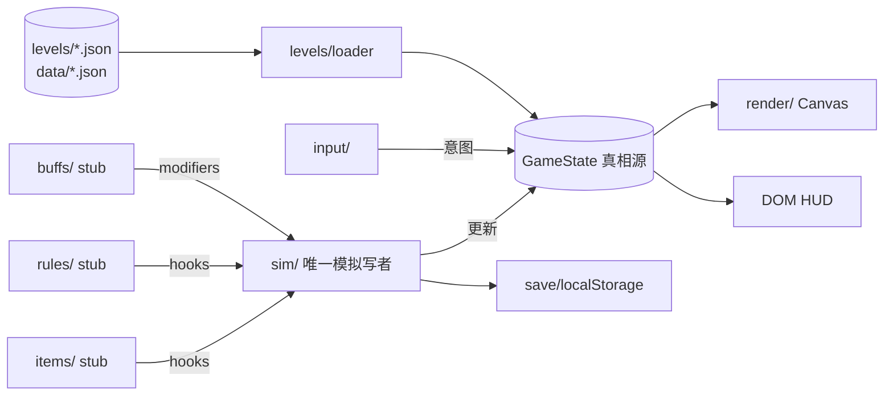
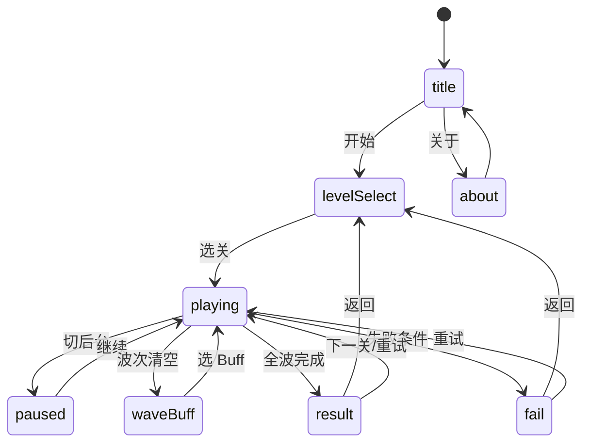
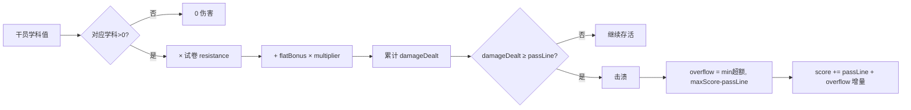

# 789罗德岛学院 · 流程策划图

> 与 [DESIGN_QUESTIONS.md](./DESIGN_QUESTIONS.md) 定稿一致 · Phase 1 实现范围

---

## 1. 产品总流程

---

## 2. 单关战斗主路径

---

## 3. 数据流（工程）

---

## 4. 阶段机（phase）

---

## 5. 伤害与击溃

---

## 6. Phase 1 vs 愿景

| 系统 | Phase 1 | 后续 |
|------|---------|------|
| 关卡 | 小学 3 关 | 初中/高中/无尽 |
| 机制 | 学科克制 | 道具/规则怪谈 |
| Buff | 3 选 1 stub | 完整 Buff 池 |
| 美术 | 几何占位 | assets/ 真图 |
| BGM | 开关 + 占位路径 | 用户上传 user/bgm |
| 失败续关 | 无 | 随机规则续命 |
