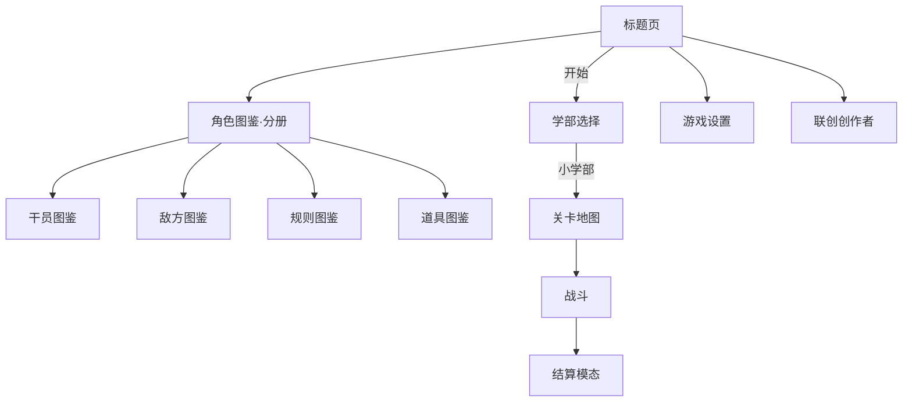

# UI 设计系统 · 789罗德岛学院

## 技术选型

| 层 | 方案 |
|----|------|
| 菜单 / HUD / 模态 | **原生 HTML + CSS 组件化**（`css/tokens.css` + `components.css` + `screens.css`） |
| 刷怪区 | **Canvas 2D**（`js/render/`） |
| 逻辑 | **原生 ES Modules**（不引入 Vue/React） |

> **重前端工程**体现在：设计 token、切角面板、动画、屏幕路由、战斗 Dock 组件化——而非引入 SPA 框架。

## 设计 Token

见 [`css/tokens.css`](../css/tokens.css)：

- 色板：深青 `#00e5ff` accent、碳灰背景、警告 `#ff6b4a`
- 切角：`clip-path` 六边形面板
- 间距 / 字号 / 动效曲线统一

布局与美感原则见 [`UI_AESTHETICS.md`](./UI_AESTHETICS.md)（8px 节奏 · CRAP · 主 CTA 对比）。

## 屏幕流（与线稿对齐）

### 标题页
- 上：品牌区（60%）789 数字主导 + 弱化印章
- 下：导航区（40%）主 CTA「开始游戏」最大最亮，次级 ghost
- 区块间距 16–24px，组内 12px

### 学部选择
- 顺序：**小学 · 高中 · 初中**（左→右）
- 动画：依次下落（delay 0 / 400 / 800ms）
- 解锁：小学默认可点；初中通关小学后解锁

### 战斗布局
- 上：`820px` Canvas · **5×5** 刷怪区
- 下：Dock · 菱形部署发射器 · 左右干员圆槽 · 底部 4 道具空槽

### 模态
- 居中、统一样式；结算三按钮：**返回 · 重试 · 下一关**

## 模块

| 路径 | 职责 |
|------|------|
| `js/ui/screens.js` | 屏幕路由 + 模态 |
| `js/ui/components.js` | 按钮、干员槽、标签 |
| `js/ui/battle-dock.js` | 战斗 HUD + Dock 更新 |
| `css/tokens.css` | 变量 |
| `css/components.css` | 通用组件 |
| `css/screens.css` | 页面布局 |

## 素材挂点

- 标题立绘：`rh-title__portrait`
- 学部卡片：`rh-dept-card__img`
- 干员头像：`assets/operators/queue|loaded/`
